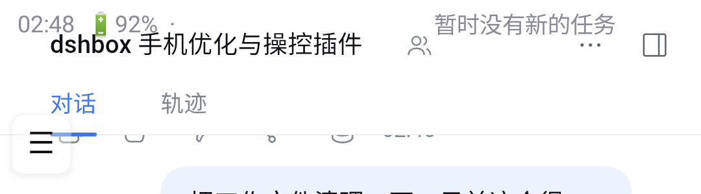

# DSH Status HUD · DSH 状态条

把 DSH agent 的**当前操作**变成一条悬浮在状态栏位置的**透明滚动条**：
左侧固定显示时间/电量，右侧无缝滚动的文字实时告诉你 agent 在做什么。
空闲时显示「暂时没有新的任务」，长任务进行中显示「🤖 正在执行 …」，完成/等待确认时也会变色提示。

> Android 10+（已在小米 9 / MIUI 12 / Android 10 上验证）· 需要 [Shizuku](https://shizuku.rikka.app/)（免 root）· MIT License

## 为什么做这个（背景）

在手机上用 **DSHBox** 跑 agent 时，任务一旦转到后台执行，用户就**看不到任何进展**：
不知道它还在干活、是不是卡住了、还是在等自己确认。切出去做别的事只能干等。

本项目把 DSH agent 的实时活动（正在调用的工具、等待确认、完成/空闲）做成
**状态栏级的滚动条**：在任何 App（刷 B 站、看视频、回消息）的上方都能看到后台进度，
不用切回 DSHBox。配合 `plugin/` 插件全自动推送，装完即用。



---

## ✨ 功能

- **状态栏级显示**：通过 Shizuku 写 `policy_control immersive.status=*` 隐藏系统状态栏，
  再用悬浮窗占据该区域 —— 在任何 App（含全屏视频、游戏）上方都能看到 agent 状态；
- **透明背景 + 滚动词条**：左侧 `HH:mm 🔋电量%` 固定，右侧环形无缝滚动操作文本，文字带阴影；
- **状态语义颜色**：🤖 运行=浅蓝、✅ 完成=浅绿、⏸ 等待确认=琥珀、空闲=灰；
- **位置可调**：上下微调 10px 步进、水平微调只移动滚动文字（避开刘海/挖孔）、一键重置；
- **背景可调**：透明 / 半透明 / 深色；
- **点击回 DSH**：点状态条直接跳回 DSHBox；
- **无障碍自动恢复**（可选）：DSH 重启后 MIUI 关掉无障碍时，通过 Shizuku 自动写回；
- **DSH 集成**：状态服务 + DSH 插件，DSH 启动时自动拉起；agent 通过 HTTP/CLI 推送状态。

## 📲 安装使用

1. 下载 [`dist/DSH-Status-Hud.apk`](dist/DSH-Status-Hud.apk) 安装（仓库内为 build.sh 生成的调试签名版）；
2. 手机安装 **Shizuku** 并按官方指引启动（Android 10 需 PC adb 启动一次）；
3. 打开「DSH 状态条」：
   - ① 授权「显示在其他应用上层」；
   - Shizuku 区域点「① 授权 Shizuku」；
   - ② 启动状态条（会写 policy_control 隐藏系统状态栏，并启动服务）；
4. 切到任意 App，顶部即可看到滚动的 DSH 状态条。

> 停止方式：App 内「③ 停止状态条」会删除 `policy_control` 并恢复系统状态栏。
> **升级提示**：APK 使用自动生成的调试签名；如果你自己重新构建过，覆盖安装前先卸载旧版。

## 🔌 与 DSH 集成（插件自动推送）

`plugin/` 是一个 DSH 插件，装好后**自动**把 agent 活动推到状态条，无需手动调用：

| DSH 事件 | 状态条显示 |
|---|---|
| `turn/start` | 🤖 处理中… |
| `tool/call` | 🔧 执行命令（bash）/ 点击手机控件（phone_click）… |
| `approval/asked` | ⏸ 等待你的确认 |
| `turn/end`（无活跃回合） | 暂时没有新的任务 |

安装：把 `plugin/` 复制到 DSH profile 的 `node_modules/@local/dsh-status-hud/`，
并在 profile `package.json` 的 `dsh.profile.bundles` 里加 `"@local/dsh-status-hud"`，重启 DSH 生效。
详见 [`plugin/README.md`](plugin/README.md)。插件还会在 DSH 启动时自动拉起状态服务。

**手动推送**（脚本/agent 想自己控制时）：

```bash
# 启动状态服务（默认 127.0.0.1:8790）
node server/status-server.js

# 推送状态
node server/status-server.js push "正在分析你的 App"   # 🤖 运行中
node server/status-server.js done "任务完成"            # ✅ 完成
node server/status-server.js idle                      # 空闲

# 或使用助手脚本
./hud.sh run "正在做什么" && ./hud.sh done "完成" && ./hud.sh idle
```

HTTP API：

| 方法 | 路径 | 说明 |
|---|---|---|
| `POST` | `/status` | `{"state":"running\|done\|blocked\|idle","text":"...","step":0,"total":0}` |
| `GET` | `/status` | 读取当前状态 |
| `POST` | `/done` / `/idle` | 完成 / 空闲 |
| `POST` | `/report` | 手机端回传诊断日志 |

## 🛠 自行构建

无需 Gradle / Android Studio，脚本直接调用 `aidl + javac + d8 + aapt + zipalign + apksigner`。

```bash
# 1) 系统依赖（Debian/Ubuntu 示例，JDK 21）
sudo apt install -y openjdk-21-jdk aidl aapt apksigner zipalign zip unzip curl

# 2) 下载 android.jar(API 29) / d8.jar / Shizuku API 13.1.5
./scripts/fetch-deps.sh

# 3) 构建（产物输出到 dist/）
cd android && bash build.sh
```

构建产物：`dist/DSH-Status-Hud.apk`（首次构建会自动生成 `android/build/debug.keystore`）。

## 🧠 原理简述

- **隐藏状态栏**：Shizuku 的 UserService 以 shell uid 执行
  `settings put global policy_control immersive.status=*`，系统状态栏在所有 App 中隐藏；
- **滚动条**：`TYPE_APPLICATION_OVERLAY` 悬浮窗 + `FLAG_LAYOUT_NO_LIMITS` 从屏幕 y=0 开始；
  高度 = 状态栏真实高度（通过 `dumpsys window` 读取并持久化）+ 2px；
- **滚动**：自绘 `RingTextView`，`offset = (elapsed * speed) % 单份宽度`，单向无缝环形滚动；
- **状态同步**：前台服务每 700ms 轮询 `http://127.0.0.1:8790/status`，变化时才重绘；
- **无障碍自动恢复**：每 ~30s 用 shell 检查 `enabled_accessibility_services`，掉线则写回。

## ⚠️ 已知限制

- 必须安装并授权 **Shizuku**（免 root 的 shell 通道）；没有 Shizuku 无法隐藏状态栏；
- `policy_control` 是 AOSP 机制，个别 ROM/定制系统可能不完全生效；
- 状态栏是被「隐藏后由悬浮条替代」，不是系统原生状态栏改造（普通 App 无法改写 SystemUI）；
- 透明背景时滚动文字会从刘海/挖孔下方经过（可用「文字右移」把起点移出挖孔区）；
- 无障碍恢复功能只针对 DSHBox 自身，不涉及其他 App。

## 📁 目录结构

```
android/            Android 源码与手动构建脚本（aidl/javac/d8/aapt/apksigner）
  src/              HudService / MainActivity / RingTextView / ShizukuShell / UserService ...
server/             状态服务（Node.js，HTTP + CLI）
plugin/             DSH 自动推送插件（监听 agent 事件，cordis bundle）
scripts/            依赖下载脚本
docs/DEVLOG.md      开发日志（Shizuku 打包踩坑、坐标/对齐、policy_control 调试记录）
screenshots/        效果截图
dist/               构建产物
```

## 📄 License

[MIT](LICENSE)

---

## 相关项目

- [dsh-qq-brain](https://github.com/0year/dsh-qq-brain) —— 双通道事件驱动 QQ 群聊大脑：大缓冲积累认知、小窗口判断兴趣、关键词廉价唤醒。配合本项目的 QQ 桥使用（手机监听通知 → 大脑处理 → 需要时自动发回 QQ）。
